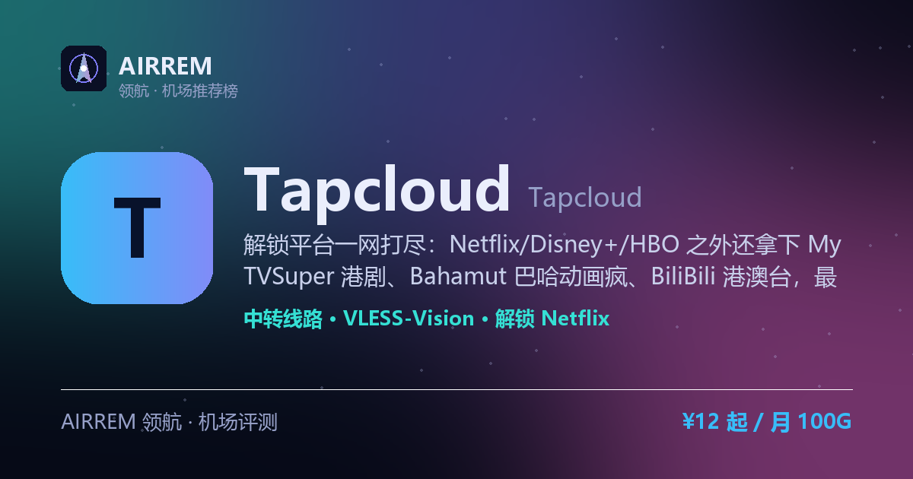

# Tapcloud机场（可信路径 · TrustedAccessPath）2026 评测｜全平台流媒体解锁｜官网入口 · 套餐价格

> **Tapcloud** 适合谁？港剧日漫欧美剧全都追，想要一家解锁平台最全的机场。解锁平台一网打尽：Netflix/Disney+/HBO 之外还拿下 MyTVSuper 港剧、Bahamut 巴哈动画疯、BiliBili 港澳台，最高 5000Mbps、支持家庭共享；月付 ¥12/100G 起（含一档 IEPL 专线），另配一次性不限时流量包，五折码 xiaoqi

👉 **[Tapcloud 官网注册入口](https://s.rtxk.us/s/5qv7zcn)** ｜ 优惠码：`xiaoqi` ｜ [完整评测与横向对比](https://555736.xyz/tapcloud/)

---

## 我们的结论

Tapcloud（品牌页署名 TrustedAccessPath / 可信路径）是 2025 年新开的中转机场，最大杀器是解锁平台特别全——除 Netflix/Disney+/ChatGPT 外，还覆盖 MyTVSuper 港剧、Bahamut 巴哈姆特动画疯、HBO、BiliBili 港澳台等，港剧日漫欧美剧一家全追；最高 5000Mbps、支持家庭共享，套餐从月付 ¥12/100G（含一档 IEPL 专线）到 ¥40/500G，另有 ¥40/80/180 一次性不限时流量包，配五折码 xiaoqi。注意它是缺乏第三方实测的新中转站、且有多个山寨/更换域名，务必认准官方地址、先小额月付验证晚高峰。

## 基本信息

| 项目 | 内容 |
| --- | --- |
| 机场名称 | Tapcloud（可信路径 · TrustedAccessPath） |
| 成立时间 | 2025 |
| 线路类型 | 公网中转（含 IEPL 专线档） |
| 支持协议 | VLESS-Vision / Hysteria2 / AnyTLS |
| 流媒体解锁 | Netflix / Disney+ / ChatGPT / MyTVSuper / HBO / Bahamut |
| 节点地区 | 洛杉矶 · 法兰克福 · 东京 · 新加坡 · 香港 等 25+ 国家 |
| 计费方式 | 月付（至 3 年付）/ 不限时流量包 |
| 起步价格 | ¥12 / 月 100G |
| 推荐场景 | 港剧日漫欧美剧全都追，想要一家解锁平台最全的机场 |

## Tapcloud 套餐价格

| 套餐 | 价格 | 说明 |
| --- | --- | --- |
| Starter 入门 | ¥12 | 月付 · 每月 100G · IEPL 专线 · 最高 5000Mbps · 5 设备 · 家庭共享 |
| Standard 标准 | ¥20 | 月付 · 每月 200G · 中转 · 5000Mbps · 5 设备 · 家庭共享 |
| Premium 旗舰 | ¥40 | 月付 · 每月 500G · 中转 · 5000Mbps · 5 设备 · 家庭共享 |
| Lite Pack 流量包 | ¥40 | 一次性买断 · 100G 用完为止 · 中转 · 5000Mbps · 5 设备 |
| Daily Pack 流量包 | ¥80 | 一次性买断 · 300G 用完为止 · IEPL 专线 · 5000Mbps · 5 设备 |
| Max Pack 流量包 | ¥180 | 一次性买断 · 1000G 用完为止 · 中转 · 5000Mbps · 5 设备 |

> 月付套餐每月按订单日重置流量，可选月 / 季 / 半年 / 年至 3 年付；流量包为一次性不限时买断、用完为止；Starter 与 Daily Pack 走 IEPL 专线，其余为中转；全档最高 5000Mbps、最多 5 台设备并支持家庭共享，仅限个人使用暂不支持退款；官网以人民币计价，五折优惠码 xiaoqi，价格以官网实时为准。

## Tapcloud 是什么

Tapcloud（品牌页署名 TrustedAccessPath，中文常称「可信路径」）是 2025 年上线的一家中转机场，官网 tapcloud.me。它把卖点压在「解锁全、带宽高、多设备家庭共享」上，主打一站式追剧与日常科学上网。

最有辨识度的是解锁清单：除了常见的 Netflix、Disney+、ChatGPT，还覆盖 MyTVSuper（香港无线剧集）、Bahamut 巴哈姆特动画疯（台湾正版番剧）、HBO、BiliBili 港澳台等，追港剧、追日漫、追欧美剧的用户几乎一家就够。

## 线路与节点

官网宣称覆盖全球 25+ 国家节点，点名洛杉矶、法兰克福、东京、新加坡、香港等常用地区，海外中转总带宽宣称约 12.5G、峰值最高 5000Mbps。整体为公网/独立服务器中转，其中 Starter、Daily Pack 两档标注走 IEPL 专线。

- 25+ 国家节点，主力港 / 日 / 新 / 美 / 德
- 最高 5000Mbps、不限制每日用量、支持家庭成员共享
- 部分档位（Starter / Daily Pack）走 IEPL 专线，其余为中转

> 💡 官网首页部分统计为占位值、带宽为宣传刻度，缺乏第三方实测；晚高峰表现请以自身线路小额验证为准。

## 协议与客户端

Tapcloud 主推 VLESS-Vision、Hysteria2（Hy2）、AnyTLS 三种较新协议，按地区自动匹配；早期版本曾用 Trojan。因协议较新，建议使用 mihomo 内核客户端（Clash Verge / FlClash 等）或 iOS 的 Shadowrocket、Karing，老客户端可能不识别。

> 💡 官网订阅地址约 300 秒后自动失效以防外泄；过期后请删除旧订阅、重新复制导入，不要用客户端「更新订阅」按钮。

## 解锁能力

解锁是 Tapcloud 的核心卖点，标称 4K 全解锁：Netflix、Disney+、HBO Max、YouTube、Apple TV+、Prime Video、Spotify、TikTok、Twitch、hulu、DAZN、AbemaTV，以及 MyTVSuper、Bahamut、BiliBili 港澳台等亚洲平台；商店页并标注支持 ChatGPT。

- 欧美：Netflix / Disney+ / HBO Max / Apple TV+ / Prime Video / hulu
- 亚洲：MyTVSuper 港剧 / Bahamut 台漫 / BiliBili 港澳台 / AbemaTV
- AI 与社交：ChatGPT、TikTok（以官网商店页为准）

## 优点与缺点

**✅ 优点**

- 解锁平台一网打尽：Netflix/Disney+/HBO + MyTVSuper 港剧 / Bahamut 台漫 / BiliBili 港澳台，港日欧美一站追
- 最高 5000Mbps、支持家庭成员共享，多设备一起用
- 协议较新（VLESS-Vision / Hysteria2 / AnyTLS），抗封更好
- 计费灵活：月付 ¥12/100G 起（含 IEPL 专线档），另有 ¥40/80/180 一次性不限时流量包
- 五折优惠码 xiaoqi，入手门槛低

**⚠️ 缺点**

- 2025 年新开的中转机场，第三方实测与晚高峰数据基本空白
- 官网首页多项统计为占位值、协议 / 带宽多来自推广口径，宣传成分需打折
- 存在多个山寨 / 更换域名，需认准官方地址，订阅链接约 300 秒自动失效
- 机场行业有跑路风险，建议先小额月付验证，别一上来就大额年付

## 适合谁 / 不适合谁

| 👍 适合 | 👎 不适合 |
| --- | --- |
| 港剧（MyTVSuper）、日漫（Bahamut）、欧美剧都追，要解锁平台最全的用户 | 只信老牌、要长期第三方实测数据的用户 |
| 要家庭共享、多设备高带宽的用户 | 追求 IEPL/IPLC 全专线极致稳定的重度用户 |
| 想灵活买不限时流量包做长期备用的用户 |  |

## 常见问题

**Q：Tapcloud 是专线机场吗？**

A：它整体是中转机场（品牌页署名 TrustedAccessPath / 可信路径），宣称用独立 5G 服务器中转、海外总带宽约 12.5G；其中 Starter 与 Daily Pack 两档标注走 IEPL 专线，其余为中转。它并非全线 IEPL/IPLC 专线，追求极致稳定可再搭配一家老牌专线机场。

**Q：Tapcloud 是新机场，靠谱吗？会不会跑路？**

A：它约 2025 年才上线，目前 NodeSeek、V2EX 等独立社区几乎没有实测口碑，正面信息多来自带返佣的推广渠道；好在暂未进入公开跑路黑名单。稳妥做法是先用月付或最低档验证晚高峰，别大额年付，并再备一两家机场容灾。

**Q：怎么避免买到山寨站？订阅为什么会失效？**

A：Tapcloud 有多个关联 / 更换域名，官方也提醒警惕搜索引擎里的假冒站，请通过本站推荐链接进入官网；此外官网订阅地址约 300 秒后自动失效，导入后若过期，删除旧订阅、重新复制导入即可，不要用客户端「更新订阅」按钮。

## 同类机场推荐

拿不定主意？可以再看看这几家同类型的：

- **[守候](https://555736.xyz/shouhou/)** — 稳健老用户 / Emby 影音，¥15 起
- **[自由猫](https://555736.xyz/freecat/)** — 日常主力，¥6 起
- **[淘气兔](https://555736.xyz/taoqitu/)** — 联通移动用户，¥7.8 起

全部 38 家机场的横向对比与选购方法论：**[信号塔 SignalTower · 机场大全](https://555736.xyz/airports/)**

---

数据更新：2026-07 ｜ 价格、套餐与优惠码以官网实时为准 ｜ 本仓库为第三方评测整理，与 Tapcloud 官方无隶属关系 ｜ 请遵守当地法律法规使用网络服务。

关键词：Tapcloud、Tapcloud机场、Tapcloud怎么样、Tapcloud靠谱吗、Tapcloud官网、Tapcloud评测、Tapcloud优惠码、Tapcloud注册、可信路径、TrustedAccessPath、全平台解锁机场、MyTVSuper解锁、Bahamut解锁、巴哈姆特动画疯、HBO解锁、BiliBili港澳台、中转机场、家庭共享机场、不限时流量包、VLESS、Hysteria2、AnyTLS、机场推荐、机场评测、Netflix解锁、ChatGPT机场
